

<a href="https://ayushkathoke.vercel.app">
  
</a>

 




  <a href="https://aicodexcompiler.vercel.app"></a>
  <a href="https://code-collabs.vercel.app"></a>
  <a href="https://github.com/Ayushkathoke/AI-Content-Genrator"></a>
  <a href="https://github.com/Ayushkathoke/Q-A-Pair-Generator-Web-App"></a>
  <a href="https://ayushkathoke.vercel.app"></a>
  <a href="https://pragyanitds.blogspot.com"></a>


  <a href="https://github.com/Ayushkathoke/PRODIGY_AD_05"></a>
  <a href="https://ayushkathoke.github.io/pwa-wrapper/"></a>
  <a href="https://github.com/Ayushkathoke/PRODIGY_AD_02"></a>
  <a href="https://ayushkathoke.github.io/AYUSH.AI/"></a>
  <a href="https://github.com/Ayushkathoke/CODSOFT"></a>
  <a href="https://github.com/Ayushkathoke/Project-hostel-pg-rental-crm-smartInternz-salesforce"></a>
  <a href="https://github.com/Ayushkathoke/PRODIGY_AD_04"></a>
  <a href="https://github.com/Ayushkathoke/PRODIGY_AD_01"></a>
  <a href="https://github.com/Ayushkathoke/ShapeAI_Python_Machine_Learning"></a>
  <a href="https://ayushkathoke.github.io/Todolist/"></a>




  
  
  
   
  
  
  


  <a href="https://archive.nptel.ac.in/noc/Ecertificate/?q=NPTEL23CS74S84280086220116005"></a>
  <a href="https://archive.nptel.ac.in/noc/Ecertificate/?q=NPTEL24CS21S65040164230050755"></a>

  <a href="https://www.hackerrank.com/certificates/81d07264bfb0"></a>
  <a href="https://www.hackerrank.com/certificates/a738b0a9827a"></a>
  <a href="https://www.hackerrank.com/certificates/ea7b8cabb662"></a>
  <a href="https://www.hackerrank.com/certificates/463c449dfa36"></a>
   
  <a href="https://www.hackerrank.com/certificates/578f29b5d789"></a>
  <a href="https://www.hackerrank.com/certificates/769fabaaa39f"></a>
  <a href="https://www.hackerrank.com/certificates/7560e344ee04"></a>
  <a href="https://www.hackerrank.com/certificates/eba6bbc3e35d"></a>


  
  
  
  
   
  
  
  


  
    
  
   
  Designed &amp; engineered by Ayush Kathoke · stats refresh daily

